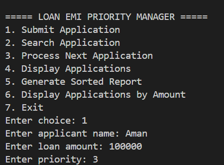
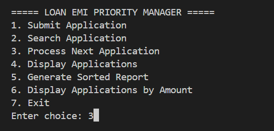
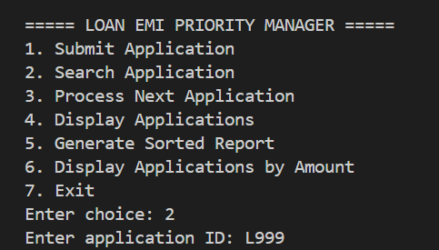
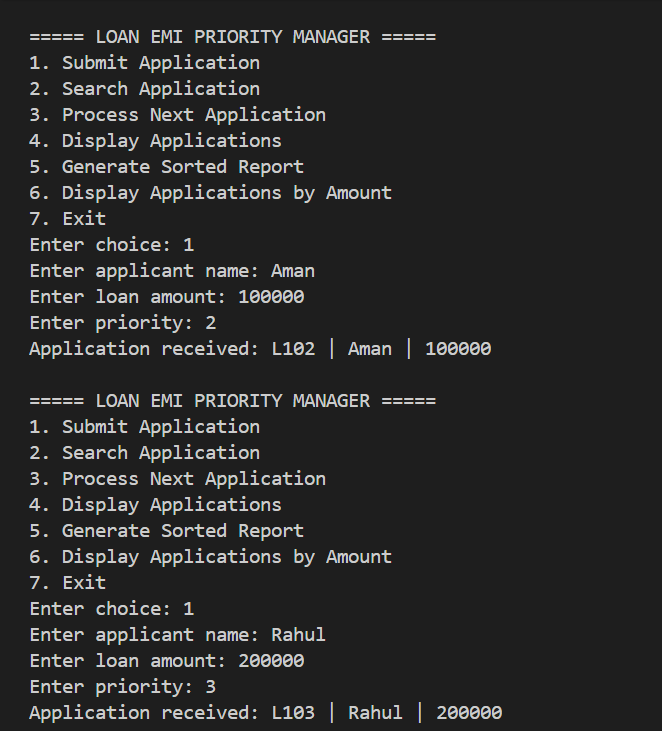
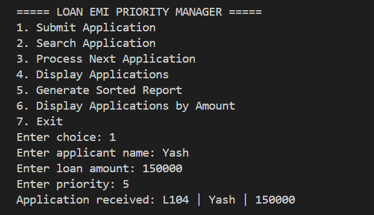
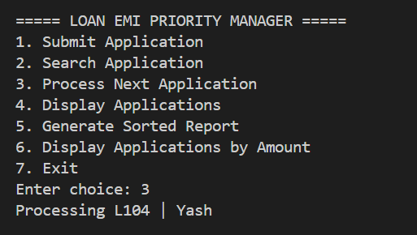

# Loan EMI Priority Manager

A Java-based application management system that stores loan applications and prioritizes them for review. This project uses different data structures and file handling concepts to manage, search, process, and organize loan applications efficiently.

## About the Project

The Loan EMI Priority Manager was developed as part of **Problem Statement 65** for the Data Structures and Algorithms (DSA) course during the 3rd semester.

The main objective is to manage loan applications and process them according to their priority.

Applications with higher priority are processed first. If two applications have the same priority, the application submitted earlier is processed first.

The project also maintains application records so that data remains available even after the program is closed.

## Features

- **Submit Application:** Add a new loan application with applicant name, loan amount, and priority.
- **Search Application:** Find an application using its unique application ID.
- **Priority-Based Processing:** Process the highest-priority pending application first.
- **Display Applications:** View all submitted loan applications.
- **Sorted Report:** Generate a report arranged by priority.
- **Sort by Loan Amount:** Display applications in ascending order of loan amount.
- **File Handling:** Save application details and load them when the program starts.
- **Input Validation:** Reject zero or negative loan amounts and invalid inputs.

## Data Structures and Concepts Used

| Concept | Purpose |
|---|---|
| Priority Queue | Processes applications according to priority |
| Binary Search Tree (BST) | Organizes applications by loan amount |
| HashMap | Searches applications using their IDs |
| Linked List | Stores all loan applications |
| ArrayList | Stores applications temporarily for sorting |
| Sorting | Generates the sorted review report |
| File Handling | Saves and loads application records |

## Technologies Used

- **Programming Language:** Java
- **JDK:** Java Development Kit
- **IDE:** Visual Studio Code
- **Concepts:** Data Structures and Algorithms, Object-Oriented Programming, File Handling

## Project Structure

```text
Loan-EMI-Priority-Manager/
│
├── LoanManager.java
├── loan_applications.txt
├── README.md
│
├── TestCase1.png
├── TestCase1Ans.png
├── TestCase2.png
├── TestCase2Ans.png
├── TestCase3.png
├── TestCase3Ans.png
├── TestCase4.png
├── TestCase4p2.png
└── TestCase4Ans.png
```

**Note:** `loan_applications.txt` is created automatically when the program saves its data.

## How to Run the Project

### 1. Clone the Repository

```bash
git clone <your-repository-url>
```

### 2. Open the Project Folder

```bash
cd Loan-EMI-Priority-Manager
```

### 3. Compile the Java File

```bash
javac LoanManager.java
```

### 4. Run the Program

```bash
java LoanManager
```

Make sure Java is installed and configured on your system.

## Application Menu

After running the program, the following menu is displayed:

```text
===== LOAN EMI PRIORITY MANAGER =====

1. Submit Application
2. Search Application
3. Process Next Application
4. Display Applications
5. Generate Sorted Report
6. Display Applications by Amount
7. Exit

Enter choice:
```

## Test Cases and Outputs

The following screenshots show the test cases and their corresponding program outputs.

### Test Case 1

**Test Case:**



**Expected Output:**


### Test Case 2

**Test Case:**



**Expected Output:**


### Test Case 3

**Test Case:**



**Expected Output:**


### Test Case 4

**Test Case:**

This test case is longer, so it is divided into two screenshots.





**Expected Output:**



## File Handling

Application records are stored in `loan_applications.txt`.

Each record contains:

```text
ApplicationID|Name|Amount|Priority|Status|Order
```

Example:

```text
L101|Aman|100000.0|3|PENDING|1
L102|Rahul|200000.0|5|PROCESSED|2
```

When the program starts, previously saved records are loaded automatically. When the user exits, the updated application records are saved to the file.

## Time Complexity

| Operation | Average Time Complexity |
|---|---|
| HashMap Search | O(1) |
| Priority Queue Insertion | O(log n) |
| Priority Queue Processing | O(log n) |
| BST Insertion | O(log n) |
| BST Traversal | O(n) |
| Sorting Report | O(n log n) |
| File Loading and Saving | O(n) |

*Note: BST insertion can take O(n) in the worst case if the tree becomes skewed.*

## Future Improvements

- Add EMI calculation based on loan amount, interest rate, and tenure.
- Add applicant details and loan categories.
- Provide separate administrator and applicant access.
- Add a graphical user interface.
- Generate downloadable loan review reports.

## Author

**Vicky Kumar**

- **ERP ID:** RU-25-11588
- **Course:** B.Tech CSE (AIML)
- **Semester:** 3rd Semester
- **University:** Rungta International Skills University
- **Location:** Bhilai, Chhattisgarh, India

## License

This project is developed for educational and academic purposes.
